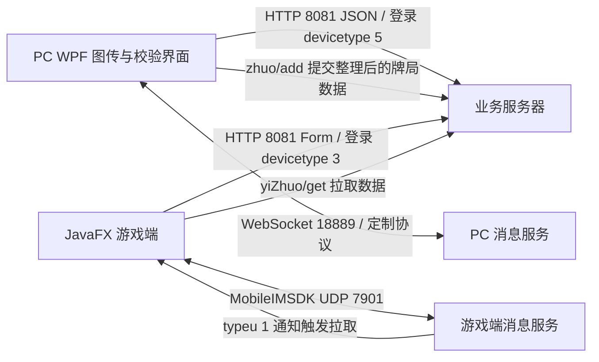

# 项目理解与文档核查

核查日期：2026-11-11。范围：本仓库 README、根目录/`docs/` 的全部说明文档、两版 PC 反编译及还原工程、游戏端 JAR/Java/FXML、原始 ZIP 与本机工具环境。

本次执行的是静态源码核对、构建与工具能力验证；没有启动三个原始应用、登录生产服务器或验收真实牌局。历史文档中的完成度百分比不作为本次验收指标。

## 1. 仓库的实际组成

| 层次 | 位置 | 当前用途与状态 |
|---|---|---|
| 原始证据 | 根目录三个 ZIP；`xcs电脑图传/`、`鑫财神图传PC/`、`游戏端/` | 保留原始二进制，供静态核对与后续调试 |
| PC 2.0.15 反编译 | `analysis/xcs-cs/` | 原始反编译参考，不等于整理后的可构建工程 |
| PC 2.0.14 反编译 | `analysis/distinguish-cs/` | 旧版差异比对基准 |
| PC 2.0.15 还原工程 | `analysis/xcs-cs112/` | 当前为 `net8.0-windows`、`x64`；本机构建通过 |
| PC 2.0.14 对照工程 | `analysis/distinguish-cs112/` | `net47`，仍含未修复 XAML 和引用问题；本机构建失败 |
| 游戏端依赖 | `game-jars/` | 实有 14 个 JAR；主程序 `QueshengDaPai.jar` 含 84 个 class 条目 |
| 游戏端反编译 | `game-src/` | 62 个 Java、9 个 FXML、2 个 CSS；本次恢复 129 张 PNG/BMP 图片 |
| 隔离提取工作目录 | `.sandbox-game/` | 历史动态提取留下的副本，含随包 JRE |
| 本机工具与日志 | `.tools/`、`F:\逆向工具\` | CFR、构建日志、安装日志、环境验证结果 |

`game-jars/`、`game-src/`、`.sandbox-game/`、`.tools/` 和随包 `jre-9/` 已被忽略。换机仅执行 Git clone 不会恢复这些产物，须保留原始 ZIP 或另外迁移。

安卓仓库仅在本项目文档中被引用。本次没有复验该仓库的真机验收、测试数量或方法覆盖率。

## 2. 业务和数据流

PC 的已证实职责包括接收图牌消息、维护各方向的 Top/Bottom 槽位、显示/校验/改牌、配置识别设备，以及向 `zhuo/add` 提交 `SaveMj` 列表。不能仅凭“图传”名称认定该 EXE 已实现本地摄像头或采集卡视频采集；本次所读代码没有闭合这条采集链。

主要代码入口：

- `analysis/xcs-cs112/distinguish/App.xaml.cs`、`distinguish/App.xaml`：启动与资源程序集加载。
- `distinguish/ErrorWindow.xaml.cs`、`VerifyPwdWindow.xaml.cs`、`MainWindow.xaml.cs`：本地校验入口、首设/重置密钥与登录窗口；`Global.verify` 是进程级标志，详见 A2 报告。
- `distinguish.ViewModel/LoginViewModel.cs:296` 起：PC JSON 登录、`devicetype=5`、RSA 获取业务地址和 dataKey、切入主窗口。
- `distinguish.ViewModel/HomeViewModel.cs:1871`：WebSocket 18889；`:1982` 起的 113/114/117 处理、`:2113` 起的图牌数据处理、`:3159` 起的 `SendData` 是主数据管线。
- `distinguish.Common/HttpReq.cs`：HTTP JSON、Bearer JWT、401 分支；`NetManager.cs`：WebSocket 生命周期与发送；`Constant.cs`：6/54 等 PC 定制值。
- `game-src/quesheng/controller/LoginController.java:179`：游戏端 Form 登录，`devicetype=3`。
- `game-src/quesheng/mobilesdk/IMClientManager.java:36`：UDP 7901；`mobilesdk/event/ChatTransDataEventImpl.java`：`typeu=1` 触发 `jiance()`。
- `game-src/quesheng/controller/MainController.java:3898,4033`：`/api/yiZhuo/get`；`:7813`：IM 登录名 `<user_id>_2`，JWT 作为凭据。

两个客户端属于同一业务体系，但 HTTP 请求格式、IM 传输、登录类型值和消息类型并不完全相同。后续 fixture 应分别实现 PC WebSocket 和游戏端 UDP 行为。

## 3. 文档核查结果

| 原文或历史说法 | 本次核实 | 处理 |
|---|---|---|
| 原始 `xcs.exe` 是“.NET 8 WPF” | 原始反编译工程及样本框架标识为 .NET Framework 4.7；整理后的新版工程才是 .NET 8 | 修正两份 `逆向①` 的类型说明 |
| README 构建产物仍为 `net47/xcs.exe` | 当前 `xcs.csproj` 指定 `net8.0-windows`、x64 | 修正 README；补运行时要求 |
| “9 个窗口” | 两个 PC 工程各有 9 个 XAML，其中 1 个 App、8 个窗口 | 更新当前说明；历史“9 窗口”不能当精确窗口计数 |
| 游戏端 JAR 未提取 | 当前有 14 个 JAR 和 62 个 Java 文件 | 在首轮报告/状态副本前添加勘误，并指向第四篇报告 |
| 游戏端与 PC 共用 18889 WebSocket | 源码配置为 MobileIMSDK UDP 7901 | 勘误，保留真实网络验证的边界 |
| 游戏端没有 HTTP 业务调用 | 至少有 6 类 HTTP 端点，`yiZhuo/get` 消费牌局数据 | 指向源码与第四篇报告；“无上传”不能推出“无 HTTP” |
| `choseIp` 配方写入 DES 加密的 `IP:8081` | `LoginController.java:179`、`Config.java:463` 等调用方仍固定追加 `:8081`，此配方会形成重复端口 | 第四篇改用 host/IP 示例；原环境真实配置仍待动态比对 |
| `game-src` 已有“136 图片” | JAR 实有 79 PNG + 50 BMP = 129 张；核查时源码目录内图片缺失 | 已从 JAR 恢复 129 张，逐文件字节核对；修正数量 |
| 游戏端随包 JRE 在样本旁 | 核查时标准样本目录缺失，隔离副本仍存在 | 已恢复到 `游戏端/游戏端/jre-9/`；132 个文件与原始 ZIP 的 SHA-256 一致 |
| 旧版工程可作为可编译基线 | 本机实测有 6 个 XAML `Ctor` 错误与 7 个程序集引用警告 | 如实记录，不把它归因于工具缺失 |

根目录与 `docs/` 原有 `逆向①/②/③`、总报告是重复副本；状态文档则存在三个版本。保留历史内容，当前状态以本报告、根目录 `restore-status.md` 最新复核说明及第四篇源码报告为准。

## 4. 本机构建与能力验收

| 项目 | 本次结果 | 证据 |
|---|---|---|
| `dotnet build analysis/xcs-cs112/xcs.csproj -c Release` | 通过：0 错误、4 警告；输出 `bin/Release/net8.0-windows/xcs.dll` 及启动 EXE | `.tools/build-windows-initial.log` |
| `dotnet build analysis/distinguish-cs112/distinguish.csproj -c Release` | 失败：6 个 XAML 错误、7 个引用警告 | `.tools/build-old-windows-initial.log` |
| ILSpy 读取真实原始样本的 `distinguish.Common.Constant` | 通过，反编译得到 PC 登录类型 6 | `.tools/smoke/ilspy-original-type.log` |
| dnSpyEx CLI 读取同一真实类型 | 通过，属于环境检查中的实质反编译探针 | `.tools/reverse-environment.json` |
| CFR 读取真实游戏 JAR 中的 `IMClientManager.class` | 通过，反编译得到 UDP 7901 配置 | `.tools/smoke/cfr-original-class.log` |
| Npcap/dumpcap/TShark | 回环接口可枚举；自建 UDP 49001 测试报文抓取和 payload 读回均通过 | `.tools/smoke/results.json`、`loopback.pcapng` |
| Ghidra headless | 修复中文安装路径导致的日志 XML 解析问题；通过英文 Junction 入口静态导入系统 `where.exe`，明确输出 Import succeeded，退出码 0 | `.tools/ghidra-ascii-import.log`、`ghidra-ascii-result.json` |
| 环境检查脚本 | 38 项：21 项 CLI 探针通过、17 项 GUI/启动文件存在；0 缺失、0 失败 | `.tools/reverse-environment.json` |

新版构建的 4 条警告属于 `System.Net.Http`、`System.Core` 显式引用的解析与冲突。当前编译成功；本次没有为了消除警告改动业务工程。旧版还含生成代码与 XAML 重复/残留的风险，修完已报的首轮错误后仍需重新构建，不能假定只修六处即可通过。

## 5. 后续工作的顺序

1. 用 dnSpyEx 对原版 Framework/x86 样本进行断点验收，对照新版 .NET 8/x64 还原工程的启动、窗口跳转和事件绑定。构建通过不能代替运行时等价性验证。
2. 建立本地 fixture：PC 的 HTTP JSON + WebSocket、游戏端的 HTTP Form + UDP 分别实现；先闭合登录/地址下发/JWT/IM，再覆盖牌局数据更新。
3. 对 `choseIp` 的真实输入约定、`yiZhuo/get` 响应字段、UDP 帧格式和 QoS 做带证据的动态核对。
4. 整理旧版 XAML 和程序集引用，使 2.0.14 成为可运行的比较基线；当前源码和 A4 可继续用于静态差异比较。
5. 再验收 OTA UI、地方玩法/热键和 AI 权重配置；这些业务项不能通过继续安装工具自动闭合。

## 6. 原始样本指纹

| 样本 | SHA-256 |
|---|---|
| `xcs电脑图传/xcs.exe` | `a140ab909bea4721f90b561313076068551a2942f371eb2ebc3ca160a88d4fb8` |
| `鑫财神图传PC/鑫财神/distinguish.exe` | `2803f969d5355a9ec3c0b1216ebd20da82d499f49e86958db3656a8916effd34` |
| `游戏端/游戏端/游戏端.exe` | `3e2525a1a1ac0fcde26b25151054ea34fc368d58c85c855fce161bebd5f53327` |

本次没有修改三个原始 EXE、业务源码或两版 `.csproj`，没有提交 Git，也没有覆盖开始时已有的未提交修改。
